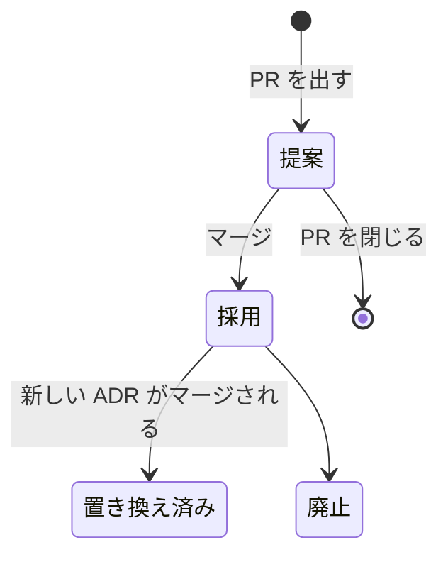

# ADR（Architecture Decision Record）

PR より長く効く判断（技術選定、構成、開発の進め方など）を、**その時点で何を、なぜ決めたか** の記録として残す。
この運用ルールを選んだ理由と別案は [ADR-0006](0006-adr-operation.md)、書く範囲（決定に何を書かないか、決めないこと、事実の根拠）は [ADR-0008](0008-adr-content-scope.md) にある。

## いつ書くか

- 次の PR や次の機能にも効く判断をしたとき。選択肢があり、捨てた案があるとき。
- その PR の中だけで閉じる判断は、PR 概要の「判断と捨てた案」に書く（[PR テンプレート](../pull_request_template.md)）。

AI が下書きしてよい。決めるのは人間で、PR のレビューとマージがその承認になる。

## 置き場所と番号

- `docs/adr/NNNN-<英語の短い名前>.md`。`NNNN` は 4 桁の連番。
- 題名は「ADR-NNNN: <決めたことを 1 文で>」。
- 並行する PR で番号がぶつかったら、後からマージする側が振り直す。
- 書き方は [テンプレート](../templates/adr.md) に従う。

## 状態

| 状態 | 意味 |
| --- | --- |
| 採用 | 今も有効な判断。マージした時点でこの状態になる |
| 置き換え済み | 新しい ADR が判断を置き換えた。状態の行に置き換えた ADR へのリンクを書く |
| 廃止 | 置き換える判断はないが、もう効いていない（対象の機能をなくした、など） |



「提案」は PR がレビュー中であることを指し、ファイルには書かない。ファイルの状態の行は、作るときから「採用（決めた日）」にする。
マージの直前に「提案 → 採用」と書き換える手間と、その書き忘れをなくすため。

## マージ後に書き換えてよい範囲

ADR は、後から読んだ人が「当時なぜそう決めたか」を確かめるためにある。だから **マージ後は判断の中身を書き換えない。**

| 書き換えてよい | 書き換えない |
| --- | --- |
| 状態の行（置き換え済み・廃止にする、置き換えた ADR へのリンク） | 背景、選択肢、決定、結果、決めないこと、確かめ方、見直しの条件の中身 |
| リンク切れの修正（ファイルの改名・移動に追随する） | 後から分かったことの追記 |
| 誤字、意味を変えない言い回し | 実装の進み具合 |

マージ前（PR がレビュー中）は、判断が変わったら自由に書き直してよい。まだ決まっていないので。

例外として、ADR-0001〜0007 は [ADR-0008](0008-adr-content-scope.md) を決めたときに一度だけ、判断を変えずに書き方を今のルールに揃えた。以後、マージ済みの ADR をルールに合わせて書き直すことはしない。

## 判断が変わったとき

1. 新しい ADR を起こす。背景に「何が変わったか」と、置き換える ADR へのリンクを書く。
2. 古い ADR の状態の行を `置き換え済み（YYYY-MM-DD、[ADR-NNNN](...)）` にする。本文は変えない。
3. 一部だけ置き換えるときは、新しい ADR に「ADR-XXXX のどの部分を置き換えるか」を書き、古い ADR の状態の行を `一部置き換え（[ADR-NNNN](...)）` にする。

同じ PR の中で古い ADR の状態の行と新しい ADR を一緒に変える。

### ADR を引用している文書を見直す

ADR の判断や、ADR に書かれた実装の細部が変わったときは、同じ PR で、その ADR を引用している文書を探して直す。
skill や checklist は AI が質問や仮の答えを作る材料なので、古いまま残ると、AI が古い前提で計画を作る。

```sh
git grep -n "ADR-NNNN" -- .claude docs ':!docs/adr' ':!docs/plans'
```

`docs/plans/` の計画は書いた時点の記録なので直さない。

### 判断は同じで、ADR に書かれた実装の細部だけが変わるとき

ADR の本文に、ポート番号やファイル名などの実装の細部が入ってしまっていることがある。
その細部だけを変えるときは、**新しい ADR を起こさず、古い ADR も書き換えない。** 変えた理由は PR 概要の「この PR だけの判断」に書く。

見分け方は「書かないこと」の表の判定の問いと同じ。「実現の方法を別の方法に替えたら、本文を書き換える必要があるか」に当てはまる記述なら実装の細部で、判断は変わっていない。
例: 「待ち受けポートは 1 つ（既定 80）」と書かれた ADR があり、80 を 8080 に変えるとき。「ポートを 1 つにする」という判断は変わらないので、ADR は触らない。今の値はコードを見る。

## 書くこと

テンプレートの見出しに加えて、次を書く。

| 書くこと | 判定の問い | 書き方 |
| --- | --- | --- |
| 前提の事実の根拠 | その事実が違っていたら、判断が変わるか | 公式ドキュメントや、確かめたコードへのリンクを添える。確かめていなければ「推測」と書く |
| 決定への反論と、その答え | 「捨てた案の方が良いのでは」「この短所は大丈夫か」と問われて答えられるか | 節を分けず、答えが属する節に書く。捨てた案の方が良いという反論は、選択肢の短所と決定の決め手に。採用した案の短所は結果に。その対策は決定の約束に |
| 決めないこと（あれば） | 読んだ人が「これも決まった」と誤解しそうな隣の論点があるか | 「この ADR で決めないこと」の節に、論点と「いつ・どこで決めるか」（例: アプリの CD を作るときに ADR で決める）を書く。Issue の番号では書かない |

前提の事実は、AI の下書きにもっともらしい誤りが混ざりやすいところ。根拠があればレビューで裏が取れ、見直しの条件も観測できる。

## 書かないこと

ADR は決めた時点の記録なので、時間とともに変わることを書くと、後から読んだ人を誤らせる。

| 書かない | 判定の問い | 例 | 代わりに |
| --- | --- | --- | --- |
| 進み具合 | 1 か月後に読んで、古くなっているか | 「実装済み」「未実装で、別の PR で作る」 | Issue や計画に書く。ADR には「この判断のために何が要るか」を書く |
| 今の値・個数 | 設定を変えたら、本文が嘘になるか | 「現在は 1 つ」「既定で `none` にしてある」 | 判断として書く（「1 つに限る」「`none` から始める」）。今の値はコードを見る |
| 実装の細部 | 実現の方法を別の方法に替えたら、本文を書き換える必要があるか | ファイル名、関数名、環境変数名、設定のキー、照合の手順 | 決定には判断と約束（「API は `/api` の下に置く」）だけを書く。コードの場所は「関連」にリンクする |
| PR やレビューの経緯 | 判断の理由か、議論の経過か | 「一度は B で実装したが、レビューで A に切り替えた」 | B を選択肢に残し、捨てた理由を書く |
| 壊れやすい参照 | ファイルの改名や Azure DevOps への移行で、指す先が変わるか | 「〇〇.md の 7 章」「Issue #14 で決める」 | ファイルへのリンクにする。ID や見出しのある文書は、ID や見出しの名前で指す |

「実装の細部」は、マージ後に書き換えない ADR では必ず古くなる。リンクはマージ後も直してよいので、コードの場所はリンクで示す。
