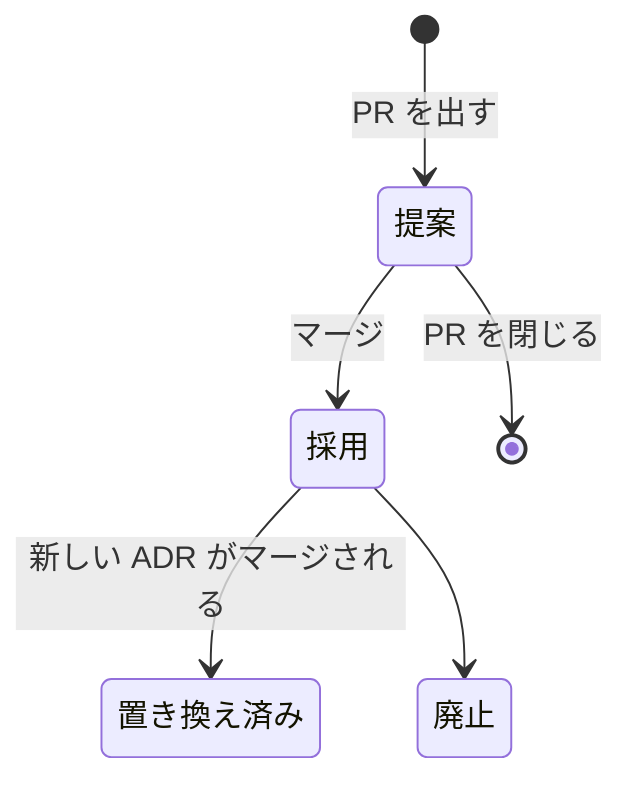

# ADR（Architecture Decision Record）

PR より長く効く判断（技術選定、構成、開発の進め方など）を、**その時点で何を、なぜ決めたか** の記録として残す。
この運用ルールを選んだ理由と別案は [ADR-0006](0006-adr-operation.md) にある。

## いつ書くか

- 次の PR や次の機能にも効く判断をしたとき。選択肢があり、捨てた案があるとき。
- その PR の中だけで閉じる判断は、PR 概要の「判断と捨てた案」に書く（[PR テンプレート](../pull_request_template.md)）。

AI が下書きしてよい。決めるのは人間で、PR のレビューとマージがその承認になる。

## 置き場所と番号

- `docs/adr/NNNN-<英語の短い名前>.md`。`NNNN` は 4 桁の連番。
- 題名は「ADR-NNNN: <決めたことを 1 文で>」。
- 並行する PR で番号がぶつかったら、後からマージする側が振り直す。
- 書き方は [テンプレート](../templates/adr.md) に従う。

## 状態

| 状態 | 意味 |
| --- | --- |
| 採用 | 今も有効な判断。マージした時点でこの状態になる |
| 置き換え済み | 新しい ADR が判断を置き換えた。状態の行に置き換えた ADR へのリンクを書く |
| 廃止 | 置き換える判断はないが、もう効いていない（対象の機能をなくした、など） |

「提案」は PR がレビュー中であることを指し、ファイルには書かない。ファイルの状態の行は、作るときから「採用（決めた日）」にする。
マージの直前に「提案 → 採用」と書き換える手間と、その書き忘れをなくすため。

## マージ後に書き換えてよい範囲

ADR は、後から読んだ人が「当時なぜそう決めたか」を確かめるためにある。だから **マージ後は判断の中身を書き換えない。**

| 書き換えてよい | 書き換えない |
| --- | --- |
| 状態の行（置き換え済み・廃止にする、置き換えた ADR へのリンク） | 背景、選択肢、決定、結果、批判的な再検討、見直しの条件の中身 |
| リンク切れの修正（ファイルの改名・移動に追随する） | 後から分かったことの追記 |
| 誤字、意味を変えない言い回し | 実装の進み具合 |

マージ前（PR がレビュー中）は、判断が変わったら自由に書き直してよい。まだ決まっていないので。

## 判断が変わったとき

1. 新しい ADR を起こす。背景に「何が変わったか」と、置き換える ADR へのリンクを書く。
2. 古い ADR の状態の行を `置き換え済み（YYYY-MM-DD、[ADR-NNNN](...)）` にする。本文は変えない。
3. 一部だけ置き換えるときは、新しい ADR に「ADR-XXXX のどの部分を置き換えるか」を書き、古い ADR の状態の行を `一部置き換え（[ADR-NNNN](...)）` にする。

同じ PR の中で古い ADR の状態の行と新しい ADR を一緒に変える。

## 書かないこと

ADR は決めた時点の記録なので、時間とともに変わることを書くと、後から読んだ人を誤らせる。

| 書かない | 例 | 代わりに |
| --- | --- | --- |
| 進み具合 | 「実装済み」「未実装で、別の PR で作る」 | Issue や計画に書く。ADR には「この判断のために何が要るか」を書く |
| 今の値・個数 | 「現在は 1 つ」「既定で `none` にしてある」 | 判断として書く（「1 つに限る」「`none` から始める」）。今の値はコードを見る |
| PR やレビューの経緯 | 「一度は B で実装したが、レビューで A に切り替えた」 | B を選択肢に残し、捨てた理由を書く |
| 壊れやすい参照 | 「〇〇.md の 7 章」 | ファイルへのリンクだけにする |
