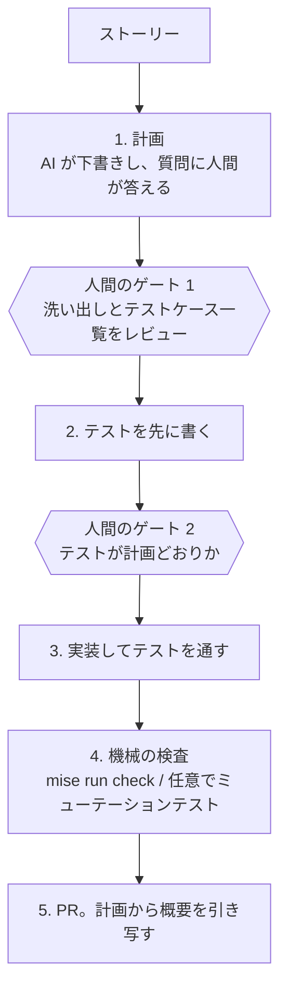

# 開発の進め方

チームで並行して開発しても、速く、コンフリクトしにくく進めるための約束。
前提となる判断は [ADR-0005](adr/0005-tests-as-specification.md)(仕様の正本はテスト、計画は使い捨て)にある。

## 1. 何を書き、何を残すか

| 文書 | いつ書くか | 残すか |
| --- | --- | --- |
| 計画([テンプレート](templates/plan.md)) | ストーリーに着手するとき | 残さない。ストーリーと PR からリンクされた履歴になるだけ |
| テスト | 計画のあと、実装より先に | 残す(仕様の正本) |
| 機能ごとの README([テンプレート](templates/feature-readme.md)) | 機能を新しく作るとき。目的・対象外・用語・関連が変わるとき | 残す(薄く) |
| ADR(`docs/adr/`) | PR より長く効く判断をしたとき | 残す |
| PR 概要([テンプレート](pull_request_template.md)) | PR を出すとき | PR に残る |

## 2. 流れ



### 1. 計画

- Claude Code のプランニング skill(`/planning`。[.claude/skills/planning/](../.claude/skills/planning/SKILL.md))で進める。計画は `docs/plans/` に書き出す([ADR-0007](adr/0007-plan-location.md))。
- AI がストーリーと既存のテストを読み、[計画テンプレート](templates/plan.md)を下書きする。
- 複雑さの種類(条件の組み合わせ、状態、順序のある計算、外部依存、時間)を見分け、種類ごとに考えるべき組み合わせを表にして並べる。表にすると、考え忘れたマスが空欄として見える。
- 埋められないマスは、AI が人間に質問する。質問に答えることで、悪手に気づき、学ぶ場にもする。質問には「なぜ聞くか」(見落とすと何が起きるか)を添える。観点は [悪手の観点](../.claude/skills/planning/checklist.md) にある。
- テストの層(単体 / 統合 / E2E)は [テスト戦略](testing-strategy.md) に沿って割り当てる。
- 小さな変更(「〜なら拒否する」程度)は、洗い出しを省いてテストケース一覧だけでよい。

### 人間のゲート 1: 計画のレビュー

コードを書く前が、誤りを直すのに一番安い。次の 3 点だけを見る。

1. 洗い出しに漏れがないか。まとめた組み合わせの理由は正しいか。
2. 既存のルールや外部依存との絡みを見落としていないか。
3. テストケース一覧の期待値は正しいか。

### 2. テストを先に書く

テストケース一覧をテストに落とす。この時点では実装がないので、テストは失敗する。

### 人間のゲート 2: テストが計画どおりか

テストケース一覧と、書かれたテスト(テスト名・パラメータの id・期待値)が一致しているかを確かめる。
```sh
mise run plan:verify <計画のファイル>   # 計画のテストケース一覧とテストを照合する(テストは実行しない)
mise run docs:spec [絞り込み]          # テストから仕様一覧を出す(例: mise run docs:spec SHIPPING)
```

`plan:verify` が機械的に照合するのは次の 3 つ。

- 計画にある ID のテストがあるか(状態が「削除」の行は、無いこと)
- テスト名が一致するか
- 計画の表の列名がテストのパラメータ名と一致する列の、値が一致するか

「入力」「期待」のように、パラメータ名と一致しない列は照合しない。値まで機械で照合したい表は、列名をパラメータ名に揃える。照合できなかった部分は、人間がテストを見て確かめる。

### 3〜5. 実装、検査、PR

- 実装は AI に任せる。テストが通ることと `mise run check` が正しさの根拠になる。
- ドメインの計算ロジックを変えたときは、ミューテーションテストの実行を検討する(任意。実行するかは人間が決める)。手元なら `mise run test:mutation`、CI なら PR に `mutation-test` ラベルを付ける。
- PR 概要は、計画の「なぜ」「判断と捨てた案」「テストケース一覧」から引き写す。
- レビューに出す前に、作成者が PR を説明できるかを確かめたいときは、理解度テストの skill(`/pr-quiz`。[.claude/skills/pr-quiz/](../.claude/skills/pr-quiz/SKILL.md))を使う(任意)。AI が書いた概要を作成者が説明できないと、レビュアーの質問に答えられず、人間が「なぜ」と「受け入れ条件」を守るという前提が崩れるため。出題は概要の人間が守る欄から出し、全問正解したら `mise run pr` を流す。

## 3. コンフリクトしない進め方

- **機能ごとに縦に切る。** 層ごと(バックエンド担当、フロント担当)に分けない。
- **共有される部分を先に小さく確定させてマージする。** 状態の追加、DB スキーマ、API 契約など、複数の作業が依存するものは、最初の PR にして先にマージする。その後で並行して進める。計画の「PR の分割」に書く。
- **ブランチは短命にする。** 1 日以内のマージを基本にする。
- **仕様の正本がテストなので、ルールの追加はたいてい別のテスト関数になる。** 同じ表(README)を全員が編集する形を避けている。

## 4. コンフリクトが起きたときの解消

1. 両方の PR の **計画(なぜとテストケース一覧)** を AI に渡し、両方の意図を満たすようにマージさせる。
2. **両方のテストが通るか** で確かめる。テストが正本なので、両方のテストが通れば両方の仕様が守られている。
3. 両方の意図が両立しない(テストの期待値がぶつかる)なら、AI では解消せず、人間が仕様として決める。

## 5. 例

- 計画の例: [抽選型商品の追加](examples/plan-lottery.md)。状態が増え、外部の決済が絡み、与信に期限があるストーリー。
