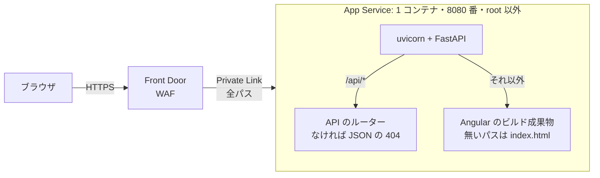
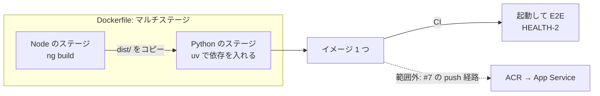

# 計画: Angular + Python を 1 コンテナ・1 App Service で動かすアプリ骨格

- ストーリー: (Issue なし。プロジェクトのスレッドでの依頼)
- 関係する機能: `backend/`(雛形)、新規 `frontend/`、`infra/workload/`(`appImage` / `appPort`)、ADR-0002 / ADR-0003

## 現在の仕様

```
| ID | テスト名 | why |
|---|---|---|
| HEALTH-1 | health returns ok | アプリが応答できるかを、外から確かめる口として使うため。 |
```

(`mise run docs:spec` の出力。backend はフレームワーク未選定の雛形で、HTTP の口はまだない)

## 1. なぜ

このテンプレートを使うチームが最初の機能のテストを書き始められるように、インフラの前提(イメージ 1 つ、ポート 1 つ、`/api` は API、それ以外は Angular)を満たし、CI で検査が回る骨格を用意する。今は backend のフレームワークが決まっておらず、HTTP の振る舞いをテストする場所がない。
Azure へのデプロイは範囲外(閉域 ACR への push 経路 #7、実デプロイ #6 に残す)。

## 2. 何を作るか

### 2-1. できるようになること

- `frontend/`(Angular)と `backend/`(FastAPI)が 1 つのイメージにまとまり、そのイメージを起動すると 8080 番で画面と API の両方に応答する。
- 画面を開くと、Angular が `/api/health` を呼び、結果(`ok`)を表示する。中身はこれだけで、業務の機能はまだ無い。
- PR の CI で、バックエンドの統合テスト、フロントエンドの lint とテスト、イメージを起動しての E2E が流れる。
- 最初の機能を作る人は、`backend/src/app/` に API を、`frontend/src/app/` に画面を足し、テストを書けば同じ CI に乗る。

### 2-2. 範囲

| 含む | 含まない(どこで扱うか) |
|---|---|
| 1 コンテナで画面と API が動く、CI で確かめる | Azure へのデプロイ(閉域 ACR への push 経路 #7、実デプロイ #6) |
| ルーティング、キャッシュのヘッダー、ヘルスチェック | 認証・認可(最初の機能か、別のストーリー) |
| フロントとバックの雛形と mise のタスク | DB(#9)、設定・シークレットの読み込み(最初に使う機能で) |
| | App Service のヘルスチェック設定、Front Door のパージ(Issue に起票) |

### 2-3. 全体像

#### リクエストの流れ(本番)



キャッシュのヘッダーもこの FastAPI が付ける(`index.html` は `no-cache`、ハッシュ付きは長期、`/api` は `no-store`)。

#### イメージの作り方



#### 手元での開発

イメージを作らずに開発できるようにする。`ng serve`(4200 番)が `/api` を uvicorn(8000 番)に中継するので、Angular は本番と同じ相対パスで API を呼べる。

#### ディレクトリ構成(この計画の後)

```
backend/            FastAPI。src/app/main.py がアプリの入口、静的配信は小さなモジュールに分ける
  tests/            統合テスト(HEALTH-1、ROUTING、CACHING)
frontend/           Angular 22 の雛形と mise.toml(setup / lint / test / build)
e2e/                pytest-playwright と mise.toml(HEALTH-2)
Dockerfile          マルチステージ。root 以外で 8080 を待ち受ける
infra/workload/     appPort の既定値だけ変える
docs/adr/           骨格の ADR を 1 つ追加(FastAPI、静的配信、root 以外)
```

## 3. テストケースの洗い出し(網羅の根拠)

### 3-1. 複雑さの種類

該当なし(構成・基盤の変更)。ドメインのルールは無いので、[checklist.md](../../.claude/skills/planning/checklist.md) の「構成・基盤」の観点で、リクエストの種類ごとの振る舞いを洗い出す。

### 3-2. 組み合わせ

コンテナに届くリクエストを、パスの種類で分けて全部並べる。

| # | パスの種類 | 例 | 返すもの | キャッシュ |
|---|---|---|---|---|
| 1 | `/api` の下にある API | `/api/health` | API の応答 | `no-store` |
| 2 | `/api` の下の存在しないパス | `/api/nothing`、`/api` | JSON の 404 | `no-store` |
| 3 | ルート | `/` | `index.html` | `no-cache` |
| 4 | 画面のパス(深いリンク) | `/orders/1` | `index.html` | `no-cache` |
| 5 | ハッシュ付きのビルド成果物 | `/main-ABCD1234.js` | そのファイル | 長期(`max-age=31536000, immutable`) |
| 6 | ハッシュの無い静的ファイル | `/favicon.ico` | そのファイル | `no-cache` |
| 7 | 存在しないファイル(拡張子あり) | `/main-OLD00000.js` | 404 | — |
| 8 | 存在しない画面のパス(拡張子なし) | `/no/such/page` | `index.html`(画面が「見つかりません」を出す) | `no-cache` |

コンテナとしての振る舞い:

| # | 確かめること | 例 |
|---|---|---|
| 9 | 8080 で待ち受け、画面と API に応答する | 起動して `/` と `/api/health` を叩く |
| 10 | root 以外のユーザーで動く | コンテナ内のプロセスの UID が 0 でない |

### 3-3. まとめた組み合わせとその理由

- 4 と 8 は、サーバーからは区別できない(どの画面のパスが存在するかは Angular のルーターだけが知る)ので、同じ振る舞いになる。テストは 4 の例だけにまとめる。
- 3・4・8 のキャッシュは「`index.html` を返すときは `no-cache`」という 1 つのルールなので、キャッシュのテストでは 3 と 4 を代表にする。
- 7 は Q3〜Q6 では聞いていない AI の判断。デプロイ直後に古いファイル名を取りにきたとき、`index.html` を返すと「JavaScript として HTML を読んで失敗する」分かりにくいエラーになる。404 の方が原因が分かる。


### 3-4. 質問と回答

| # | 質問 | なぜ聞くか | 回答 | 影響 |
|---|---|---|---|---|
| Q1 | なぜ(下書き)は合っているか | なぜがずれると洗い出し全体がずれる。デプロイまで含めると #7 が前提になり PR の分け方が変わる | 合っている(デプロイは範囲外) | 範囲を手元と CI でコンテナが動くまでにする |
| Q2 | Python の API フレームワーク | 後から替えると全 API とテストの書き直しになる、骨格で一番戻しにくい判断 | FastAPI | ADR に残す。型から OpenAPI を出し Angular の型を生成できる |
| Q3 | Angular のビルド成果物を誰が返すか | nginx 同居だと 2 プロセスになり、片方だけ落ちても気づけない(失敗に気づけるか) | FastAPI が返す | 振り分けを pytest の統合テストで確かめられる。Q6 のキャッシュ設定も FastAPI 側で持つ |
| Q4 | コンテナの実行ユーザーと待ち受けポート | 80 番は root でないと開けず、root で動かすと脆弱性の被害がコンテナ全体に広がる。変えると infra の appPort と ADR-0003 の前提が変わる(セキュリティ境界、既存の契約の破壊) | root 以外 + 8080 | infra の appPort 既定値を 8080 に変える差分が入る。コンテナが root 以外で動くことを検査する |
| Q5 | `/api` の未知のパスとヘルスチェック | 全部 index.html にすると API の呼び間違いが 200 の HTML で返り原因を追えない。health に DB を含めると DB 障害で再起動が繰り返される(構成・基盤) | `/api` の未知のパスは JSON の 404、`/api/health` はプロセスの応答のみ | 統合テストが 2 本増える。HEALTH-1 は HTTP 経由に変更。App Service のヘルスチェック設定は別 Issue |
| Q6 | index.html・ビルド成果物・API 応答のキャッシュ | ハッシュ付きファイルはデプロイで消えるので、index.html がキャッシュされるとデプロイ直後に白画面になる。共通基盤の Front Door でキャッシュが最初から有効だと、API 応答の保存は他人の情報の漏えいになる(既存の契約の破壊、セキュリティ境界) | index.html は no-cache、ハッシュ付きは長期、`/api` は no-store(`/api` はやり取りの中で AI が追加し、カードの選択で了承) | 統合テストが 3 本増える。Front Door のパージは CD を作るときの Issue。共通基盤のヘッダー上書き設定の有無は確かめられていないこと |
| Q7 | イメージが起動して応答することを CI で確かめるか | pytest の統合テストは Docker を通らないので、root 以外で動くか・8080 か・ビルド成果物の置き場所は、イメージを起動しないと分からない。Azure で初めて見つかると原因を追いにくい(構成・基盤) | E2E で担保する(Yuki の提案)。ビルドしたイメージを CI で起動し、画面を開くと API の状態が表示されるところまで 1 本。root 以外で動くことは振る舞いではないので Dockerfile の静的検査(hadolint)で見る | コンテナ専用のテストをやめ、E2E 1 本 + Dockerfile の lint にする |

## 4. 判断と捨てた案

### ADR に残す判断

#### 1. API のフレームワーク(Q2)

##### 採用
- **FastAPI。** 型から OpenAPI を出し、Angular 側の型を生成できる。フロントとバックの契約のずれを機械で見つける方針に合う。

##### 不採用
- Django(+ Ninja / DRF): ORM・管理画面・マイグレーションが揃うが、SPA + API だけには重い。
- Flask: 型と OpenAPI に別の拡張が要り、契約のずれを見つける仕組みを自前で足すことになる。

#### 2. 静的ファイルの配信(Q3)

##### 採用
- **FastAPI が Angular のビルド成果物を返す。** 1 コンテナ 1 プロセスで済み、振り分けを pytest の統合テストで確かめられる。性能は Front Door のキャッシュで補う(ADR-0003)。

##### 不採用
- nginx を同居させる: 1 コンテナに 2 プロセスになり、片方だけ落ちても気づけない。振り分けはコンテナを動かさないと確かめられない。

#### 3. コンテナの実行ユーザーとポート(Q4)

##### 採用
- **root 以外のユーザーで 8080 を待ち受ける。** infra の `appPort` の既定値を 8080 に変える。

##### 不採用
- root で 80: 脆弱性があったときにコンテナ内の全権限を取られる。
- root 以外で 80(特権ポートを開く権限だけを与える): infra は変えずに済むが、Dockerfile が複雑になり、権限の付与がレビューで見落とされやすい。

> ADR-0003 の「待ち受けポートは 1 つ(`appPort`、既定 80)」は、判断(ポートは 1 つで infra の引数で渡す)は変わらず、実装の細部(既定値)だけが変わる。ADR の運用ルール([docs/adr/README.md](../adr/README.md)、PR #20 で追加)に従い、ADR-0003 は書き換えず、新しい ADR でも置き換えとは書かない。新しい ADR の決定は「root 以外で動かし、1024 未満のポートを使わない」という判断の形で書き、8080 という値は書かない。値を変えた理由は PR 概要の「この PR だけの判断」に書く。

### この PR だけの判断(ADR に残さない)

#### 4. API 応答と静的ファイルのキャッシュ(Q6)

##### 採用
- **`index.html` は `no-cache`、ハッシュ付きのビルド成果物は長期、`/api` は `no-store`、ハッシュの無い静的ファイルは `no-cache`。** デプロイ直後の白画面と、共有のキャッシュによる他人の応答の漏えいを防ぐ。

##### 不採用
- 何も設定しない: Front Door のキャッシュが(共通基盤などで)有効だと、デプロイ直後の白画面と API 応答の漏えいが起きうる。
- デプロイのたびに Front Door をパージする: ブラウザのキャッシュは消せない。Front Door のキャッシュを有効にするときに CD に足す(Issue に起票)。

#### 5. 存在しないファイル(拡張子あり)は 404(「組み合わせ」の 7)

##### 採用
- **拡張子のあるパスでファイルが無ければ 404。拡張子の無いパスは `index.html`。**

##### 不採用
- すべて `index.html`: 古いファイル名の読み込みが HTML として返り、原因の分かりにくいエラーになる。

#### 6. イメージが動くことの確かめ方(Q7)

##### 採用
- **ビルドしたイメージを起動し、E2E を 1 本流す(`e2e/` コンポーネント、pytest-playwright)。** 画面を開くと、Angular が相対パスで `/api/health` を呼び、その結果を表示する。起動・8080・ビルド成果物の置き場所・相対パスでの API 呼び出し(ADR-0003)をまとめて確かめられる。pytest なのでテスト ID と計画を `plan:verify` で結べる。
- **root 以外で動くことは hadolint(Dockerfile の静的検査、DL3002)で見る。** 利用者から見える振る舞いではなく、イメージの設定なので。

##### 不採用
- コンテナ専用のテスト(起動して HTTP で叩き、UID を確かめる): E2E と確かめることが重なる。
- 手元だけで確かめる: Azure で初めて見つかると原因を追いにくい。

## 5. テストケース一覧

### 層の割り当て

| 判断 | 置き場所 | 層 |
|---|---|---|
| パスの振り分け、キャッシュのヘッダー、ヘルスチェック | `backend/src/app/main.py`(FastAPI のアプリ)、静的配信は小さなモジュールに分ける | 統合(TestClient。ビルド成果物はテスト用の一時ディレクトリで用意する) |
| イメージが動き、画面から API に届くこと | `Dockerfile`、`frontend/`(Angular 22) | E2E 1 本(CI でイメージを起動して流す) |
| root 以外で動くこと | `Dockerfile` | 静的検査(hadolint) |

### 統合: パスの振り分け

網羅の軸: 「組み合わせ」のパスの種類 1〜7(8 は 4 にまとめた)。

| ID | テスト名 | 入力 | 期待 | 状態 |
|---|---|---|---|---|
| HEALTH-1 | ヘルスチェックはプロセスが応答すれば ok を返す | `GET /api/health` | 200、`{"status": "ok"}` | 変更(関数の呼び出しから HTTP に) |
| ROUTING-1 | api の下の存在しないパスは JSON の 404 を返す | `/api/nothing`、`/api` | 404、JSON | 新規 |
| ROUTING-2 | 画面のパスは index.html を返す | `/`、`/orders/1` | 200、`index.html` の中身 | 新規 |
| ROUTING-3 | 存在する静的ファイルはそのファイルを返す | `/main-ABCD1234.js`、`/favicon.ico` | 200、そのファイルの中身 | 新規 |
| ROUTING-4 | 拡張子のある存在しないファイルは 404 を返す | `/main-OLD00000.js` | 404 | 新規 |

### 統合: キャッシュ

網羅の軸: 返すものの種類(`index.html` / ハッシュ付き / ハッシュなし / API)ごとに 1 ケース。

| ID | テスト名 | 入力 | 期待 | 状態 |
|---|---|---|---|---|
| CACHING-1 | index.html を返すときはキャッシュさせない | `/`、`/orders/1` | `Cache-Control: no-cache` | 新規 |
| CACHING-2 | ハッシュ付きのビルド成果物は長くキャッシュさせる | `/main-ABCD1234.js` | `Cache-Control: public, max-age=31536000, immutable` | 新規 |
| CACHING-3 | ハッシュの無い静的ファイルはキャッシュさせない | `/favicon.ico` | `Cache-Control: no-cache` | 新規 |
| CACHING-4 | API の応答は共有のキャッシュに保存させない | `/api/health`、`/api/nothing` | `Cache-Control: no-store` | 新規 |

### E2E

| ID | テスト名 | 状態 |
|---|---|---|
| HEALTH-2 | 画面を開くと API の状態が表示される | 新規 |

### 増えなかったもの

- フロントエンドの単体テスト: Angular の雛形の既定のテストだけを残す。表示のロジックがまだ無い。`mise run test` で流れるようにはする。
- 設定(環境変数)の読み込み: まだ読む設定が無い。Key Vault 参照の環境変数を読む最初の機能で足す。

### 確かめられていないこと

- Front Door が `no-cache` を「保存しない」と「毎回確かめる」のどちらで扱うか(推測のまま)。共通基盤の Front Door にオリジンのヘッダーを上書きする設定があると、CACHING-1〜4 が効かない。
- デプロイの瞬間に画面を開いたままの人が、古い遅延読み込みのファイルを取りにいくと 404 になる(Angular 側で再読み込みする話。範囲外)。
- Azure 上で動くこと(閉域 ACR への push 経路 #7、実デプロイ #6 が先)。
- フロントエンドのテストは `docs:spec` / `plan:verify` の対象外(pytest だけを読む)。

## 6. PR の分割

| PR | 中身 | テスト ID | 依存 |
|---|---|---|---|
| 1 | 計画、ADR、FastAPI のアプリ(振り分け・キャッシュ・ヘルスチェック) | HEALTH-1、ROUTING-1〜4、CACHING-1〜4 | なし |
| 2 | Angular の雛形(`frontend/`、mise のタスク、手元で API に中継する設定、API の状態を表示する画面) | (pytest なし) | なし(1 と並行できる。`/api/health` の形だけ 1 に合わせる) |
| 3 | Dockerfile(hadolint)、E2E、CI のジョブ、infra の `appPort` を 8080 に | HEALTH-2 | 1、2 |
